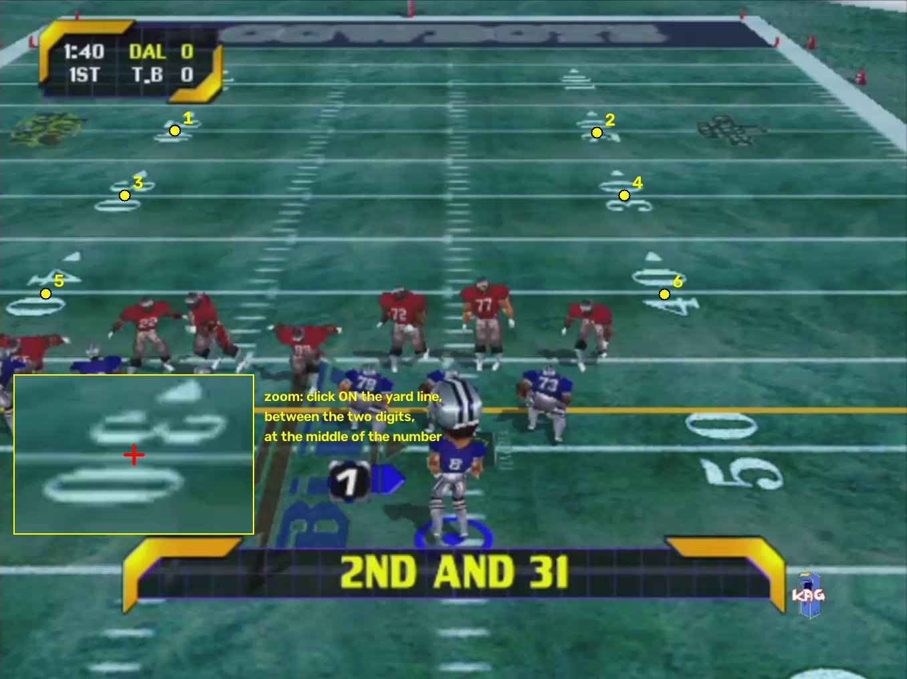

# NFL Blitz Field and Camera Tracker

OpenCV prototype for detecting football-field lines, establishing a fixed field coordinate system, and tracking virtual camera movement in prerecorded NFL Blitz 2000 footage.

## Setup

```bash
python3 -m venv .venv
source .venv/bin/activate
python3 -m pip install -r requirements.txt
```

Put gameplay clips in `data/input/` and run every command from the repository root. Clips are referred to by the start of their file name (for example `Clip_2`), so names with spaces need no quotes.

## 1. Field-Line Detection (optional)

```bash
python -m src.main
```

Processes every clip in `data/input/` and saves `data/output/<clip>_lines.mp4`.

## 2. Calibrate a Clip

Once per clip:

```bash
python -m src.initialize_homography Clip_2
```

Click the center of each painted yard number, in the order shown on screen: on the yard line, between the two digits, at the middle of the number's width.



```text
1: 20-yard line, left number    2: 20-yard line, right number
3: 30-yard line, left number    4: 30-yard line, right number
5: 40-yard line, left number    6: 40-yard line, right number
```

Controls: left click to select, `U` undo, `R` reset, `Enter` calculate, `Esc` cancel.

Options:

| Option | Use |
| --- | --- |
| `--frame N` | Click on frame `N` instead of frame 0, if points are covered |
| `--yard-lines 10 20 30` | Click different yard lines |
| `--far-half` | The yard lines are on the half away from the COWBOYS end zone (needed for `Clip_1`, where the 20 is nearest the bottom of the screen) |
| `--reuse-clicks` | Recalculate from the points clicked last time instead of clicking again. Run this for every clip after changing `src/field_model.py` |

Saves `data/output/<clip>_homography.npz` and `data/output/<clip>_homography_preview.png`. Check that the purple grid sits on the yard lines; if not, run it again.

## 3. Track the Clip

```bash
python -m src.track_video Clip_2
```

Leave out the name to track every calibrated clip. Saves:

- `data/output/<clip>_tracked.mp4`: the purple grid should stay on the painted lines as the camera moves.
- `data/output/<clip>_tracking.npz`: for every frame, the homography, line error, tracked point count, status, whether it was snapped, and whether the frame repeats the previous one.

Each frame, the tracked points predict where the grid moved, and the grid is then snapped onto the painted yard lines so errors cannot build up. When the camera moves too fast for the tracked points, features matched between the two frames give the prediction instead. The status bar ends with `snapped`, or with `predicted` when fewer than 3 yard lines were visible to snap to.

The status bar also shows the line error: the median distance, in pixels, from the projected yard lines to the nearest painted line. It is GOOD under 1.5 px, FAIR under 4 px, and LOST beyond that or when too little of the grid is on the visible field to measure. Snapping only moves the grid across the yard lines; its position along them still comes from the tracked points.

To compare clips and see when drift starts:

```bash
python -m src.tracking_report
```

This prints each clip's median and 95th-percentile line error, its share of LOST frames, and the median line error for every 30 frames.

## 4. Solve the Camera

```bash
python -m src.solve_camera Clip_4
```

Leave out the name to solve every tracked clip. Fits a pinhole camera to the tracked grid: one focal length for the clip, unless the fit shows it changing, plus the camera's position, pan, tilt, and roll on every frame, smoothed over time. Prints how wide the lens is, how closely the camera matches the tracked grid, and its line error. Saves:

- `data/output/<clip>_camera.npz`: for every frame, the focal length, the position in yards (x and y as in `src/field_model.py`, plus height above the field), pan, tilt, and roll in degrees, the OpenCV rotation and translation, and the camera's homography. Frames the tracker lost are filled in from their neighbors and marked `filled`.
- `data/output/<clip>_camera.json`: the same camera as JSON, for other tools.
- `data/output/<clip>_camera.mp4`: on the left, the footage with the solved camera's grid, which should stay on the painted lines. On the right, an overview of the camera moving over the field: the yellow pyramid is the camera (its triangle marks the top of the picture), the blue area is what it sees, and the magenta line is its path, with a shadow on the field. Frames filled in from their neighbors draw the camera in gray.

## Example

```bash
source .venv/bin/activate
python -m src.initialize_homography Clip_3
python -m src.initialize_homography Clip_2
python -m src.initialize_homography Clip_4
python -m src.initialize_homography Clip_1 --far-half
python -m src.track_video
python -m src.solve_camera
```
